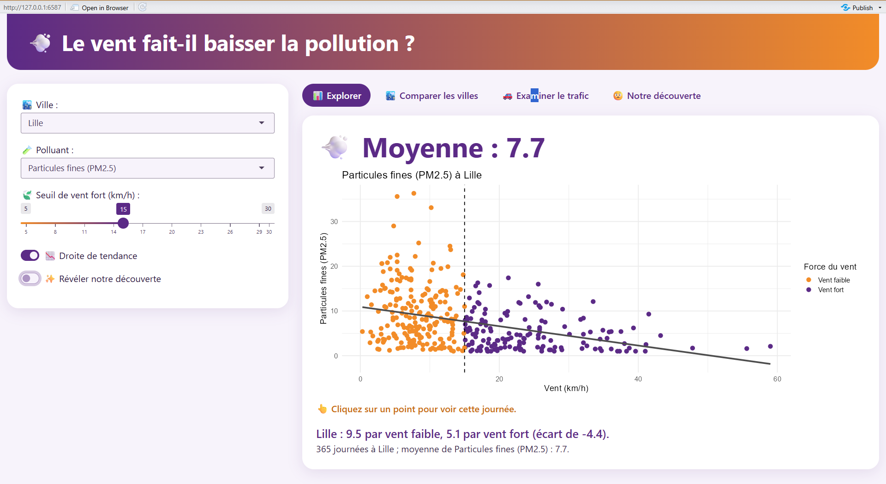

# Le vent fait-il baisser la pollution ?

Application web interactive en **R Shiny** qui explore le lien entre la force du vent et la pollution de l'air dans six villes.

> Projet académique réalisé en binôme à JUNIA ISEN Lille (cours d'analyse de données avec R, novembre 2026).
> Les données sont un **jeu pédagogique simulé** fourni pour le cours, pas des mesures officielles.

<!-- Ajoute ici une capture de l'application :  -->

## La question

Les jours de vent fort, la pollution baisse-t-elle ? Et l'effet est-il le même pour tous les polluants ?

## Les données

`08_air_quality.csv` : **2 190 relevés journaliers** sur l'année 2025, pour 6 villes (Bruxelles, Lille, Lyon, Marseille, Paris, Strasbourg).

| Colonne | Contenu |
|---|---|
| `date`, `city` | jour et ville |
| `pm25`, `no2`, `o3` | particules fines, dioxyde d'azote, ozone |
| `temperature_c`, `wind_kmh` | température (°C) et vent (km/h) |
| `traffic_index` | indice de trafic routier |

## Ce que fait l'application

- **Explorer** : nuage de points vent / polluant pour une ville, avec un **seuil de vent fort réglable**, une droite de tendance et le détail d'une journée au clic.
- **Comparer les villes** : moyennes par vent faible et par vent fort dans les six villes.
- **Examiner le trafic** : la même comparaison à trafic comparable (trafic coupé à sa médiane), pour vérifier que le vent n'est pas un simple reflet du trafic.
- **Notre découverte** : un quiz où le visiteur devine quel polluant baisse le moins, avant de révéler la réponse.

## Résultats

Avec un seuil de vent fort à 15 km/h, sur les six villes réunies :

| Polluant | Baisse moyenne par vent fort |
|---|---|
| NO₂ | **32 %** |
| PM2,5 | **35 %** |
| O₃ | **2 %** |

La baisse du NO₂ se retrouve dans chacune des six villes, et dans les deux groupes de trafic. L'ozone, lui, ne baisse presque pas. Il s'agit d'une association observée dans ces données, pas d'une preuve de causalité.

## Lancer l'application

Dans R ou RStudio, depuis le dossier du projet :

```r
install.packages(c("shiny", "bslib", "dplyr", "ggplot2", "readr"))
shiny::runApp()
```

## Technologies

R · Shiny · bslib · dplyr · ggplot2 · readr

## Travail en binôme et usage de l'IA

Nous avons conçu l'application à deux. J'ai proposé et intégré le quiz destiné aux visiteurs. L'IA a servi à adapter et déboguer le code Shiny ; le choix de la question, de la découverte mise en avant et de la structure du code est le nôtre. Le détail est dans [`journal.txt`](journal.txt).
